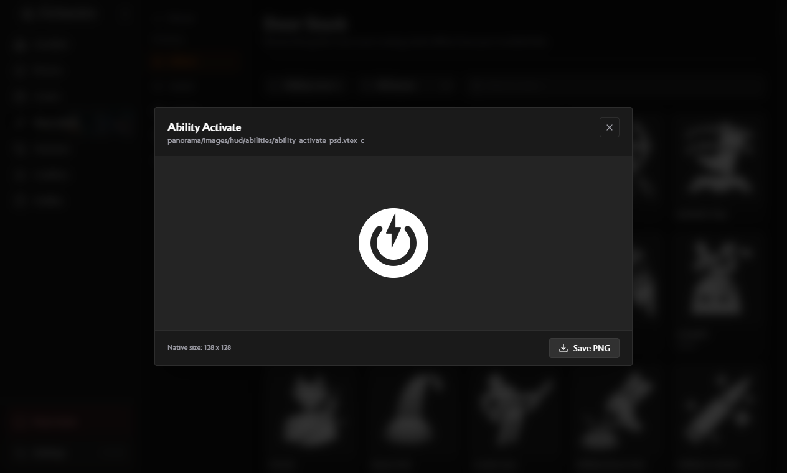
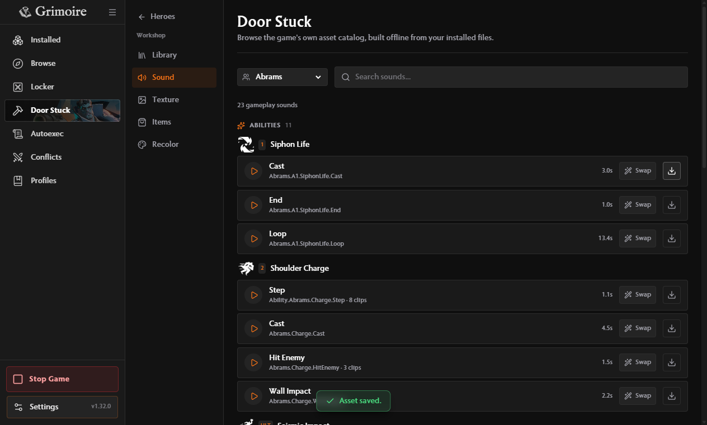

# Save Door Stuck assets

Open a texture in the Library or Texture tool and choose **Save PNG**. The file
uses the texture's native dimensions, including textures larger than the 1024px
preview limit.

Sound rows have a download button labelled **Save preview as MP3**. It saves the
same first clip the play button auditions. Events with several clips still show
their clip count. Voice lines use the same action.

Both actions open a native save dialog. Cancelling writes nothing. Unsupported
assets report an error instead of saving a thumbnail or an empty file.

Packaged Windows verification used an isolated profile and game directory with
Deadlock build 26059233. A Vyper armor texture saved at 2048 x 2048. Abrams's
Siphon Life cast saved as a playable 44.1 kHz stereo MP3 lasting 2.971814 seconds.
Automated native-dialog selections exercised the real renderer, IPC, decoder,
cache and file-copy paths. Cancellation and a 1024px window were also checked.

