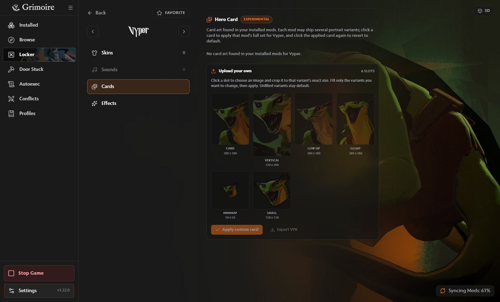

# Vyper hero cards

Vyper's engine codename is `viper`, but its hero definition references `kali_*`
for the card, vertical, low-HP, gloat, minimap and small portrait textures.

The shared portrait lookup accepts both names. This lets the Locker find cards
in installed packs and load all six templates for custom uploads. Apply, export,
revert and applied thumbnails already use that lookup, so the stored hero
identity stays `viper` while the replacement textures keep their `kali_*` paths.

Verified against Deadlock build 26059233: all six hero-definition fields point to
`kali_*`, all six templates decode in the packaged Windows app, and a custom card
exports at `panorama/images/heroes/kali_card_psd.vtex_c`. The exported VPK was
decoded again to confirm the path and 280 x 380 dimensions. In-game rendering was
not tested.

